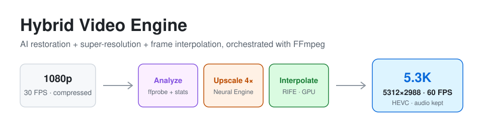
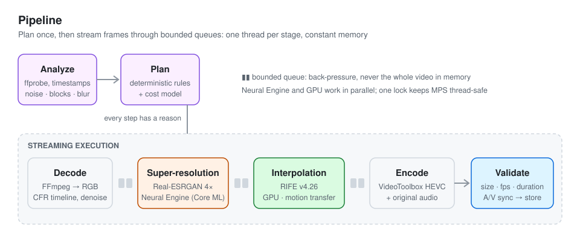
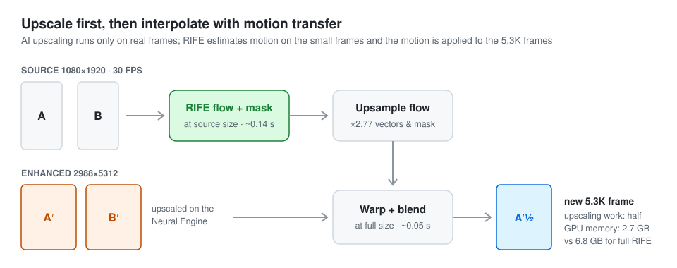
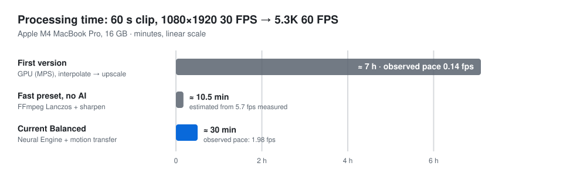
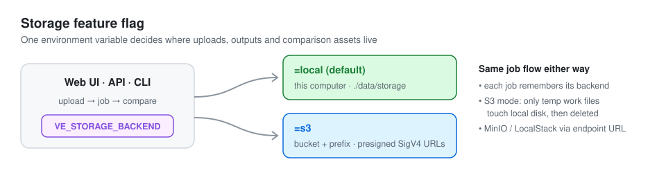

<p align="center">
  
</p>

<p align="center">
  <a href="#quick-start">Quick start</a> ·
  <a href="docs/ARCHITECTURE.md">Architecture</a> ·
  <a href="docs/PERFORMANCE.md">Performance</a> ·
  <a href="docs/STORAGE.md">Storage (local / S3)</a> ·
  <a href="#api">API</a>
</p>

<p align="center">
  
  
  
  
</p>

# Hybrid Video Engine

Turns blurry, compressed or low-resolution video into **5312×2988 (5.3K) at 60 FPS**, locally on a Mac.
A web UI lets you upload a clip, watch progress with a time estimate, and compare
**original vs enhanced side by side** with synced zoom, plus the file-size difference.

The engine doesn't run one fixed filter chain. It **analyzes each video and plans what it needs**:

- A clean 5.3K60 source is left alone.
- A 720p30 phone clip is restored, upscaled 4× with AI, and interpolated to 60 FPS.
- A compressed clip is deblocked *before* upscaling, so the AI doesn't sharpen the blocks.
- Every decision ships with a human-readable reason, and every result passes a validation report (resolution, FPS, duration, frame count, audio sync) before it counts as done.

> AI reconstructs visual detail · FFmpeg handles media and timing · a deterministic planner decides how they work together.

## Features

| | |
|---|---|
| 🔍 **Analyzer** | ffprobe + timestamp scan: VFR, rotation, anamorphic pixels, HDR, interlacing, audio. Measures noise, compression blocking and blur on real frames |
| 🧠 **Planner** | Frame-rate policy (preserve / interpolate / repeat / decimate), orientation-aware geometry, restoration choice, and a cost model that picks the fastest stage order that fits in memory |
| ⬆️ **Super-resolution** | Real-ESRGAN *general-x4v3* (compact, 1.2M params) on the **Apple Neural Engine via Core ML**, with GPU (MPS) fallback |
| 🎞️ **Interpolation** | RIFE v4.26 with exact rational timelines (24/25/30/50 → 60), scene-cut protection, and **motion transfer** from source frames to the 5.3K frames |
| 🎬 **Encoding** | Hardware HEVC (VideoToolbox), BT.709 tagging, original audio copied bit-exact (or AAC when the container needs it) |
| 🖥️ **Web UI** | Upload, live progress and ETA, time estimate before upload, side-by-side and wipe comparison with synced 2–8× zoom, 1:1 detail crops, size and bitrate comparison |
| 🗄️ **Storage flag** | `VE_STORAGE_BACKEND=local` keeps files on this machine; `=s3` keeps them in S3 with presigned URLs |
| ✅ **Tests** | 65 tests: analyzer, planner policies, timeline maths, audio sync, AI pipeline, Core ML vs MPS parity, local and S3 storage (moto), API |

## How it works

<p align="center"></p>

The expensive step is AI upscaling, so the engine upscales **only the real frames**. It then creates the in-between
frames by estimating motion on the small source frames and applying that motion to the enhanced 5.3K frames:

<p align="center"></p>

More detail: **[docs/ARCHITECTURE.md](docs/ARCHITECTURE.md)**.

## Performance

<p align="center"></p>

On an M4 MacBook Pro, a 60 s 1080p30 clip goes to 5.3K60 in about **30 minutes** (it took about 7 hours before the
Neural Engine and motion-transfer work). The UI estimates the time before you upload and learns from every finished
job on your machine. Measurements, the benchmark harness and the cloud-GPU outlook are in
**[docs/PERFORMANCE.md](docs/PERFORMANCE.md)**.

## Quick start

Requirements: macOS on Apple Silicon (Linux/CPU works, but slowly), Python 3.11–3.13, `ffmpeg`, and [uv](https://docs.astral.sh/uv/).

```bash
brew install ffmpeg
git clone https://github.com/mohdhasnain-pixel/hybrid-video-engine.git
cd hybrid-video-engine
uv venv --python 3.12 && uv pip install -e ".[dev]"

uv run video-engine download-models   # ~50 MB, checksums pinned (Real-ESRGAN + RIFE)
uv run video-engine serve --reload    # → http://127.0.0.1:8000
```

Open the page, drop in a video, check the estimate, and press **Upload & enhance**.
Start with a few seconds (*Process only*) before you commit to a full clip.

### Command line

```bash
uv run video-engine analyze clip.mp4                 # source profile + degradation estimate (JSON)
uv run video-engine plan clip.mp4 --preset quality   # what would run, why, and how long it would take
uv run video-engine enhance clip.mp4 out.mp4 --max-seconds 10 --report job.json
uv run video-engine calibrate                        # measure this Mac for sharper time estimates
```

### Presets

| Preset | What it does | When to use it |
|---|---|---|
| `fast` | FFmpeg Lanczos + sharpening, frames repeated to 60 FPS, no AI | Quick previews |
| `balanced` *(default)* | Conservative restoration, AI upscaling, RIFE when below 60 FPS | Most footage |
| `quality` | Stronger restoration, AI from 1.3×, 10-bit HEVC, temporal report | Final renders |
| `restoration` | Restoration always on, AI from 1.1×, hallucination warning | Very degraded footage |

Presets are YAML files in [`configs/`](configs). They describe policies, not hard-coded models.

## Storage: local disk or S3

<p align="center"></p>

```bash
# default: everything under ./data/storage on this computer
uv run video-engine serve

# S3: uploads, outputs and comparison assets in a bucket
VE_STORAGE_BACKEND=s3 VE_S3_BUCKET=my-bucket VE_S3_REGION=us-east-1 uv run video-engine serve
```

See **[docs/STORAGE.md](docs/STORAGE.md)** and [`.env.example`](.env.example) for every setting.

## API

| Method | Path | Description |
|---|---|---|
| `GET` | `/` | Web UI |
| `GET` | `/api/config` | Storage backend, presets, models, device, FFmpeg capabilities |
| `GET` | `/api/estimate?width=&height=&duration=` | Processing-time estimate before upload |
| `POST` | `/api/jobs` | Multipart `file` + `preset`, `output_policy` (`5k3`/`native`), `interpolation`, `aspect_mode`, `codec`, `max_seconds`, `start_seconds`, `preserve_audio` |
| `GET` | `/api/jobs` · `/api/jobs/{id}` | Job state, plan with reasons, metrics, validation, URLs, size comparison |
| `POST` | `/api/jobs/{id}/cancel` | Cancel a running job |
| `DELETE` | `/api/jobs/{id}` | Delete a job and its stored files (local or S3) |
| `GET` | `/files/{key}` | Local-backend file serving with HTTP range support |

## Project layout

```
configs/            quality presets (YAML)
src/video_engine/   analyzer · degradation · planner · decoder · encoder · pipeline
                    super_resolution · coreml_sr · interpolation · perf · validation
                    compare · storage · jobs · server · cli · models/ (SRVGG, RIFE)
web/index.html      single-file frontend (no build step)
benchmarks/         quality benchmark (PSNR / SSIM / temporal error)
tests/              pytest suite
docs/               architecture, performance, storage + diagrams
```

## Honest limitations

- **AI upscaling invents plausible detail.** Faces, text, logos and number plates may not match reality, and the UI says so.
- **Strong motion blur or defocus can't be truly undone.** No dedicated deblur model is bundled.
- **HDR is processed as SDR**, with a warning (FFmpeg without `zscale`).
- **5.3K60 is heavy.** Even with no AI, encoding 60 s takes about 10 minutes on an M4. For 5–10 minute turnaround at full quality you need an NVIDIA GPU (see [docs/PERFORMANCE.md](docs/PERFORMANCE.md#going-faster)).
- **Chrome may not play 5.3K HEVC.** The UI plays an H.264 preview instead; the full file plays in Safari.

## Credits & license

Code: [MIT](LICENSE). Models are downloaded separately and keep their own licenses:
[Real-ESRGAN](https://github.com/xinntao/Real-ESRGAN) (BSD-3-Clause, Xintao Wang et al.) and
[Practical-RIFE](https://github.com/hzwer/Practical-RIFE) (MIT, hzwer). The network definitions in
`src/video_engine/models/` are adapted from those projects.
